# Sightline

**Test witness testimony inside a 3D reconstruction of the crash.**

Sightline is for personal-injury and insurance-defense lawyers and the reconstruction experts they work with. You upload a crash case: reports, statements, photos, diagrams, and video such as videotaped depositions or dashcam. Gemini 4 Argon reads and watches all of it in one call and extracts vehicles, occluders, timing and witness positions. A human confirms them. Argon then writes a 3D world of the crash as code, and the loop checks its own work:

1. We render the world from each witness's eyes.
2. Independent geometry and physics checks run, with no AI in them.
3. Argon watches the renders next to the evidence and patches the world.

The output is a reconstruction you can stand inside, plus findings that cite report pages and video timestamps, exportable as a PDF report.

Built at the Gemini 4 Argon SF Hackathon, Oct 25, 2026. **Track 2: More Dimensions.**

- Demo video (1 min): `TODO`
- Team: `TODO name (@github)`, `TODO name (@github)`

## Compared with what lawyers pay for today

Each pair puts a frame from a commercial forensic animation (left) next to the same kind of view from Sightline (right). Our frames come from the World B reconstruction: Argon wrote it in one pass from 849k tokens of case files, then corrected it once. Each Sightline frame also shows live speeds, the time to impact, and a check of whether the witness could see the car, with the testimony cited.

| | |
|---|---|
| **Witness-eye view** | 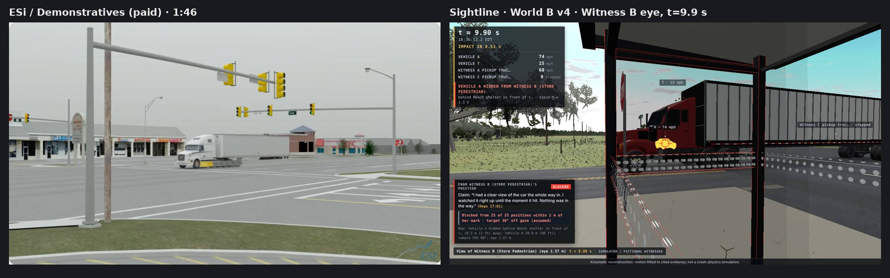 |
| **Chase view behind the striking car** | 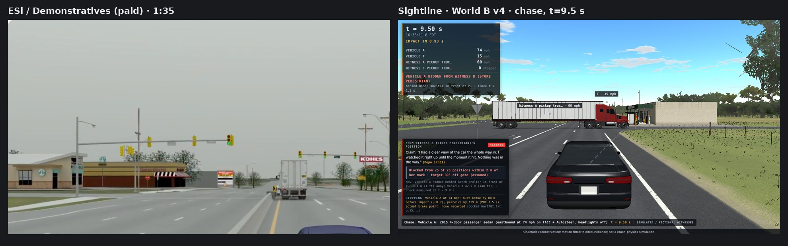 |
| **Driver / witness inside a vehicle** | 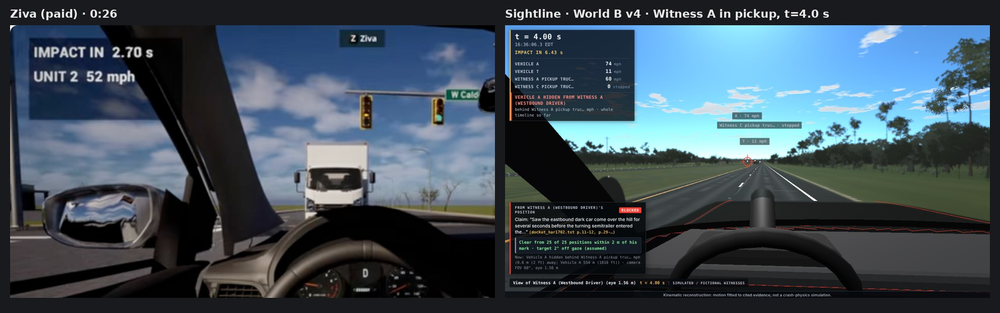 |
| **Second witness (inside the store)** | 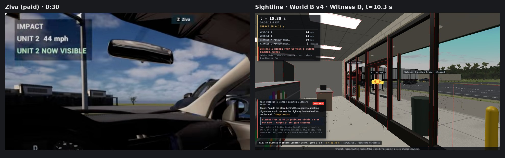 |

Reference frames are single stills, credited and shown for comparison only. ESi / Demonstratives, "Night Time Semi Collision Visualization" (youtube.com/watch?v=Y7Api99fPuw), 1:46 and 1:35. Ziva, "Crash Reconstruction for Legal in Unreal" (youtube.com/watch?v=JlXN-FTQxDE), 0:26 and 0:30. They are not our work, and they come from different crashes than ours. Sightline frames: `cases/demo-full/renders/world_v4/final/`.

> **Data notice.** The demo case uses **real public crash facts**: the NTSB docket and Highway Accident Report NTSB/HAR-17/02 for accident **HWY16FH018** (US-27A near Williston, Florida, May 7, 2016), cited by page. **Witnesses A–D are fictional, and both deposition videos are simulated** (generated from scripts; no real names). The aerial photo is **USGS The National Map / NAIP** (public domain). Values NTSB did not report are labeled as inferred. Sightline is an analysis aid for experts, not evidence.

## Run it on a laptop

Requirements: Node 22 and ffmpeg. Chromium for headless rendering comes with the npm packages.

```bash
git clone https://github.com/Welddevelopment/Sightline---argon-4-hack-sf.git sightline
cd sightline
npm install
cp .env.example .env
```

Edit `.env` (never commit it):

```
GEMINI_API_KEY=your-key
SIGHTLINE_MODE=live
```

```bash
npm run dev
```

1. Open **http://localhost:5173/cases.html**.
2. Click **Demo case**, then **Start demo**.
3. Walk the step bar: Upload → Extract → Review & confirm → Reconstruct → Findings → Test a witness → Export.
   Exact clicks: **Start demo** → **2 Extract** → **Run extraction** → type a name + **Confirm and build** → viewer opens on Witness B → **Add a witness** → **Export report**.

The demo case is a copy of the pre-run `demo-full` case. **Extract and Reconstruct replay the recorded live run**: a badge says so, and the log prints the real timings. Everything after that runs for real on your machine: confirming (and moving) witnesses re-runs the independent checks, a new witness statement is a live Argon call, and export builds the report.

Without a key, `SIGHTLINE_MODE=mock` replays cached Argon outputs. Rendering and checks still run. A brand-new case needs live mode: create it at `/cases.html`, upload files, and press Run.

Other commands:

```bash
npm run smoke                              # check the key and models
node argon/loop.js --case <caseId>         # generate → render → check → critique → patch from the CLI
node argon/fleet.mjs demo-full             # replay the Managed Agents verification run (add --live to run it)
```

## What happens in the demo case

- **Input:** 212 pages from 17 documents of the real NTSB HWY16FH018 docket, plus two simulated depositions of fictional witnesses (Witness B 2 h 00 min, Witness D 45 min), plus the Exhibit 4 map. In total, one Argon call reads **849,454 input tokens: 704,100 video, 131,190 text, 14,164 image** (`cases/demo-full/cache/generate_world.meta.json`).
- **The visual-only fact:** at **Depo Witness B 1:54:30** Witness B marks where she stood on Exhibit 4 with a pen and says only "Right about here." Argon found and cited that moment.
- **The verdict:** from her marked position, the independent ray-cast finds her view of the car **blocked by the bench shelter and the turning tractor at t = 9.9 s**, from **all 25** positions in a 2 m disc around her mark (shelter 11, tractor 14). Her claim is "I had a clear view of the car the whole way in… Nothing was in the way." The gaze angle to the car is 29.5° (gaze assumed toward the impact point).
- **The loop:** one Argon response wrote the whole world (World B, 251 s). Argon's correction round, given the 1:54:34 pen-mark frame and the check results, re-measured Witness B's mark from (7.5, 12.0) to (8.5, 9.0) and made the driving witnesses ride in their pickups (326 s) → **world_v4**, the demo world. Later rounds that fixed NTSB misses but introduced impossible accelerations (1.05 g, 4.4 g) were rejected by the checks.
- **Second opinion:** 23 Managed Agents re-ran every check in separate sandboxes and reproduced all 9 check verdicts (see below).

## Walkthrough: every step, and how it works

### 1 · Upload

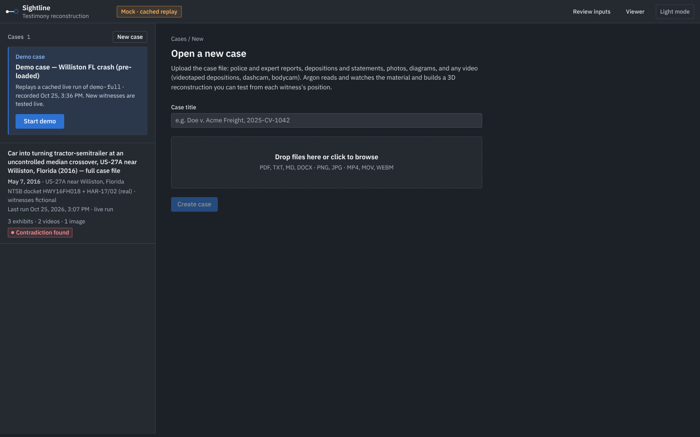

A case is a folder of evidence: PDFs, text, images and video. The server extracts text with page markers, so every later citation can point at a page, and reads each video's real length with ffprobe. **Start demo** opens a fresh copy of the pre-run full case (`cases/demo-full`).

### 2 · Extract (Gemini 4 Argon, one call)

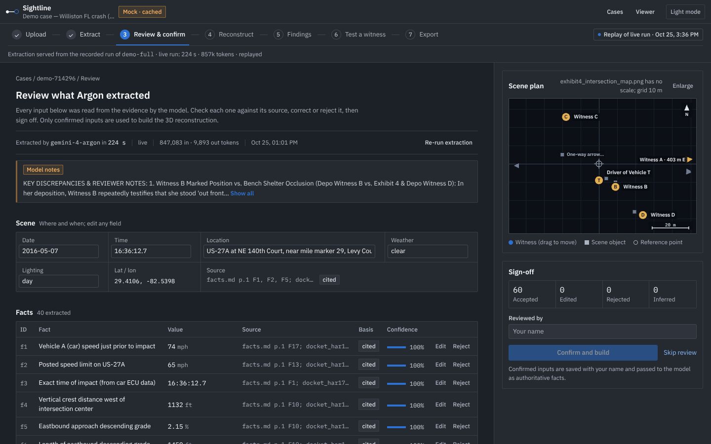

`argon/extract.js` sends **the whole case in one context**: all 212 pages, both deposition videos (uploaded with the Files API) and the exhibit image. That's 847k input tokens. Argon returns a structured extraction with a citation for every item: the scene, 40 facts, vehicles, occluders (buildings, shelters, signs) and each witness's claim, marked position and observation time. The live run took 224 s. Nothing is hard-coded: the prompts and code contain no facts about this crash.

### 3 · Review and confirm (a human signs off)

The review screen shows every extracted item next to its source. Clicking a citation opens the page or seeks the video to the timestamp. A reviewer can edit or reject any item and drag witnesses on the scene plan, then signs with a name. Only confirmed inputs go forward. If a witness is moved, the independent checks re-run on the confirmed position: dragging Witness B 6 m flips her from BLOCKED to VISIBLE. The tool shows that the finding depends on her mark instead of hiding it.

### 4 · Reconstruct (Argon writes the world, checks catch its mistakes)

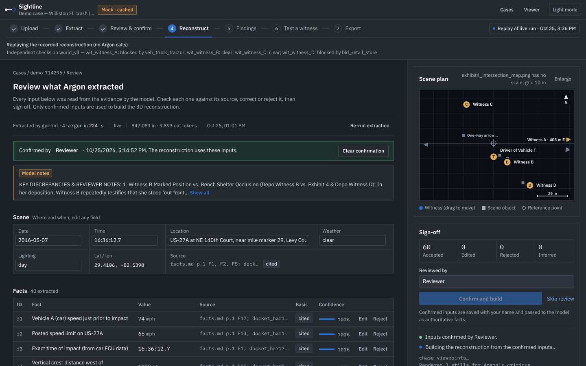

- **One-pass world.** A single Interactions API call read **839,188 input tokens** (133,504 text + 705,684 video) and wrote the complete 3D world as one JavaScript module: **16,798 output tokens, 251 s, natural stop**. It places vehicles, buildings, the bench shelter, signs and terrain from our shared asset library over the registered USGS aerial. Each vehicle has a deterministic `setTime(t)` motion fitted to the cited evidence, and every object and witness has a citation (`SPEC.md` has the world contract). A validator checks the contract, and one repair call fixed the module.
- **Independent checks, with no model** (`checks/`):
  - **Sight lines:** a ray from each witness's eye height to the target at the moment they describe.
  - **Robustness:** the same ray from 25 positions in a 2 m disc around the mark.
  - **Gaze:** the angle from where the witness was assumed to be looking.
  - **Timing:** perception-reaction windows.
  - **Plausibility:** any vehicle over 1 g fails.
- **Self-correction.** Argon is given renders of its own world next to the evidence (including the 1:54:34 pen-mark frame) and the check results, and patches the world. In the one-pass world it had read Witness B's mark as (7.5, 12.0). The critique re-measured it with the exhibit's scale bar to **(8.5, 9.0)**, the south edge of the bench shelter. It set her moment to 9.9 s ("right up until it hit"), and made the two driving witnesses ride in their pickups (326 s, 864k tokens in). That is **world_v4**, the demo world.
- **Errors trigger rounds automatically** (`argon/world_errors.js`). The loop keeps going while the *world* is wrong: it breaks the format, a vehicle moves impossibly, or it disagrees with a known fact (the NTSB report, or a witness mark the lawyer confirmed). Those errors are sent to Argon. A witness being blocked is a finding, never an error. After 3 rounds with errors left, the user is asked whether to run more. On World B this caught Argon's own regressions. Round 4 fixed three of four NTSB misses (8/12 → 11/12) but pushed the truck to 1.05 g, and round 5 made a pickup jump 4.4 g. The checks rejected both, so v4 stayed.

### 5 · Findings (look through her eyes)

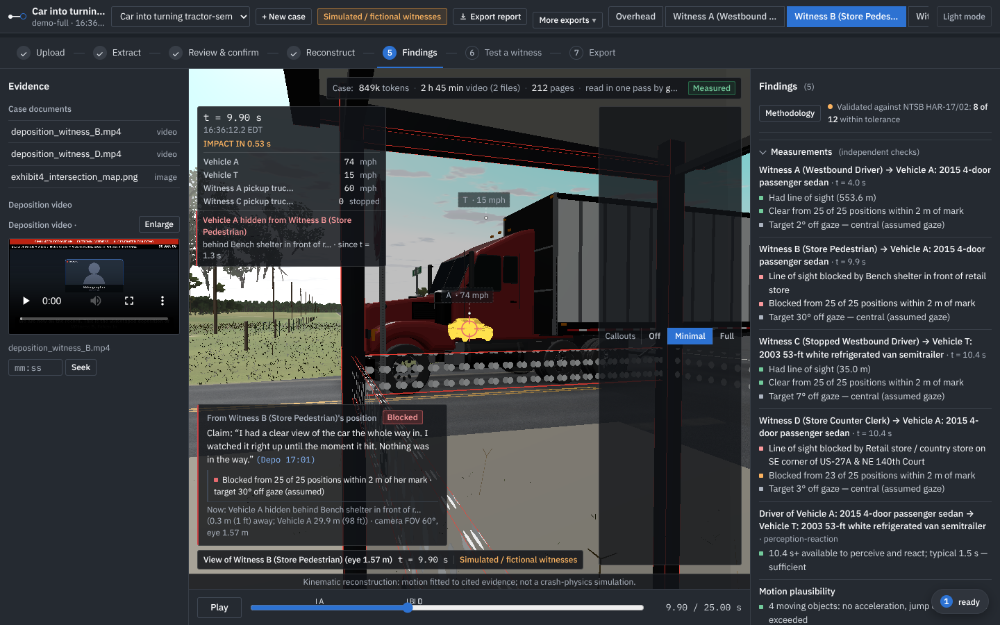

The viewer opens on the contradicted witness's own eye view at the checked moment. The card shows her sworn claim with its deposition timestamp, the verdict (**Blocked from 25 of 25 positions within 2 m of her mark**), what blocks her and the distance. The camera bar switches between the overhead, each witness and a chase view; each jumps to its relevant moment. The right panel lists every finding and every check, with the deposition frame next to the eye-view render.

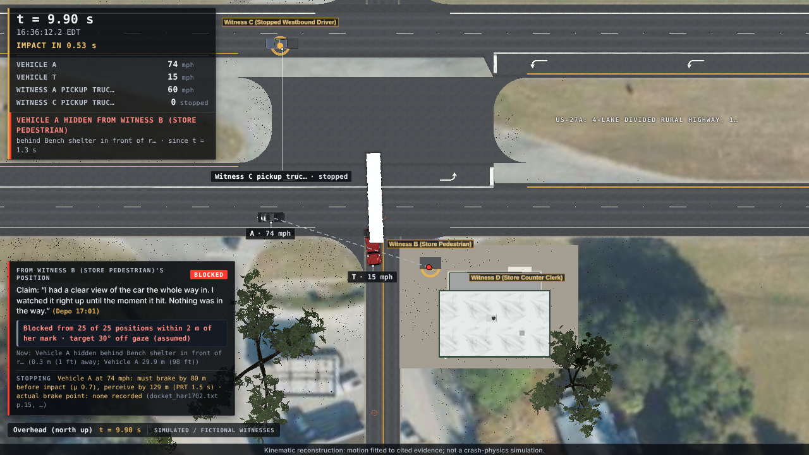

### 6 · Test a new witness (seconds, live Argon)

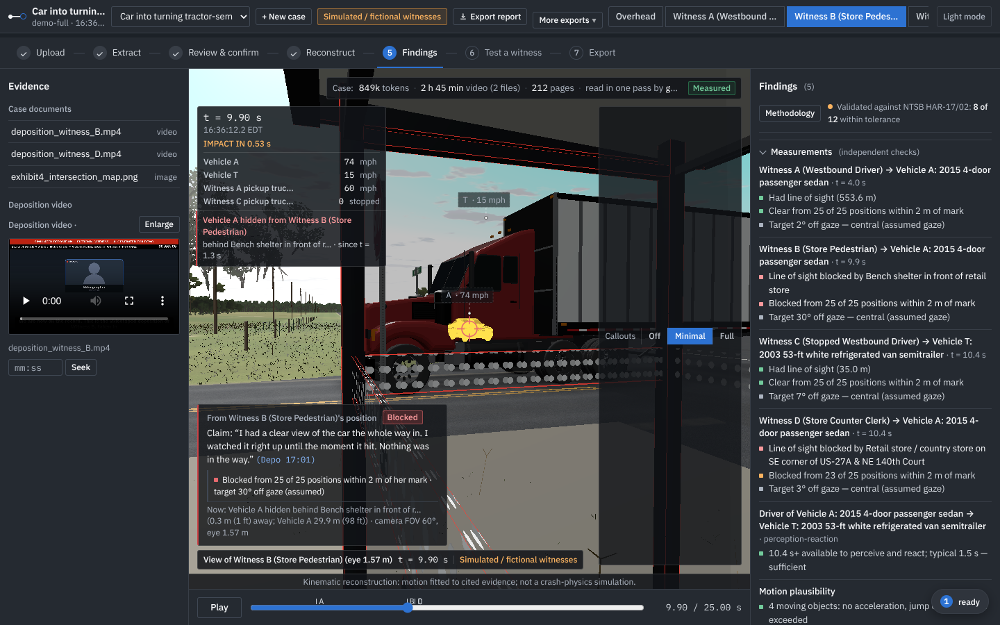

Paste any new statement in plain English. Argon (`argon/new_witness.js`) places the person in the existing world from the words alone: where they were, eye height (standing, seated), what they were looking at, and when. It writes its assumptions out. The same independent check then says VISIBLE or BLOCKED. Live calls took 5.6–9.7 s. Example: *"I was standing on the far side of the highway at the northeast corner… and watched the black car go straight under the trailer"* comes back **BLOCKED by the semitrailer**, which stood between them and the car.

### 7 · Export

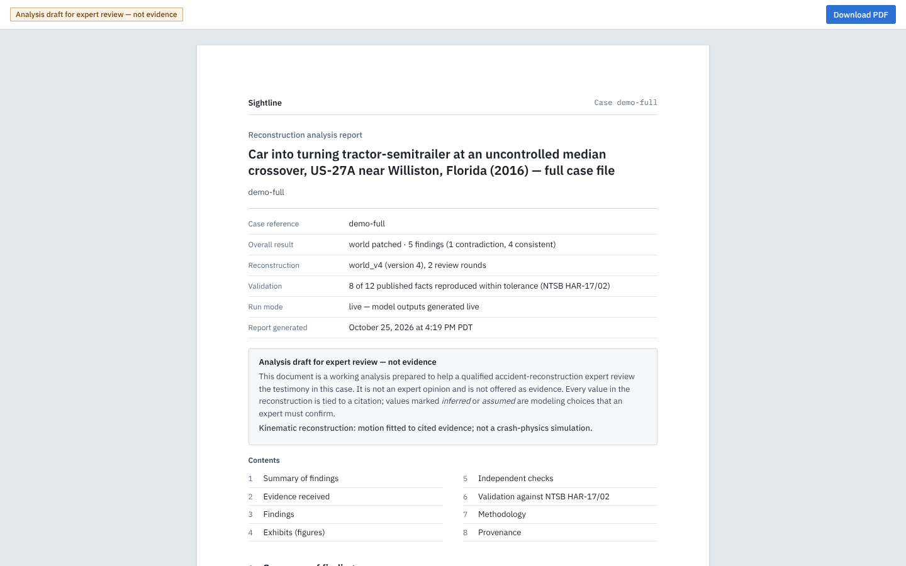

`server/report.js` builds a cited PDF for the expert: the summary of findings, the evidence received with SHA-256 hashes, every finding with its citations and check results, figures from each witness's eyes, the NTSB validation, the methodology and provenance (model, prompt hash, input hashes per world version). The 3D scene also exports as glTF (`.glb`) plus JSON.

## Why it needs Argon

- **Long context, video-native.** One call over 849k tokens: nearly three hours of video and a 212-page docket. The decisive position is only drawn on screen, never spoken, so a transcript pipeline has nothing to read.
- **Long decode.** One Argon response wrote the whole full-case world from 839,188 input tokens: 16,798 output tokens, 952 lines, 251 s. For the small 30-minute case, one response wrote a fully hand-built world of 63,079 output tokens (4,266 lines) that loads and passes the timing and plausibility checks. In a test, one response produced 200,000 output tokens (493k characters) in about 31 minutes (`cases/demo/cache/longdecode_test/meta.json`, not used in the product).
- **Honest limit.** On our small 30-minute case, Gemini Flash given the same video and documents also found the contradiction (`status/baseline_fair.md`). The viewer's comparison card is labeled exactly: "Gemini Flash · chunk-and-summarize pipeline over the transcript · no video". The case for Argon is the scale of the full case. The one-pass world first misplaced Witness B by 5.5 m; Argon's correction round fixed it, and that corrected world (world_v4) is the demo world (`status/onepass_full.md`).

## Architecture

```
evidence (PDF, text, images, video)
   │  server/cases.js: upload, text extraction with page markers, ffprobe
   ▼
argon/extract.js ── Argon, whole case + videos in one context ──► extraction (vehicles, occluders, witnesses, citations)
   │
web/review.html ── human confirms / drags witnesses ──► confirmed_facts.json
   │
argon/generate_world.js ── Argon writes a world module (JS) ──► argon/validate_world.js (+ one repair call)
   │
   ├─► render/record.js (Playwright + Three.js): overhead + witness-eye stills
   ├─► checks/ (no model): ray-cast sightlines, 25-point robustness disc, gaze angle, timing, plausibility
   ▼
argon/critique.js ── Argon watches renders + depositions + check results ──► findings with citations + patched world
   │       (argon/loop.js runs generate → render → check → critique → patch)
   ├─► argon/fleet.mjs ── Argon plans → N Managed Agents re-run checks in sandboxes → Argon merges
   ▼
web/ viewer: 3D world over the USGS aerial, witness cameras, findings with citation chips that open the page or seek the video
server/report.js, scene_export.js, clips.js: PDF report, .glb/.json scene, witness-view clips
```

| Path | What it is |
|---|---|
| `server/` | Express API and static server (port 5173): cases, ingest, review, demo replay, aerial, exports |
| `argon/` | Gemini client (mock/live), prompts, extract, generate, validate, critique, new witness, loop, fleet, one-pass and long-decode runners |
| `checks/` | Independent geometry and physics checks (no model) |
| `render/` | Headless renderer |
| `web/` | Case list, review screen, 3D viewer, asset library (`web/assets/`) |
| `deposition/`, `case_full/` | Simulated-deposition generator and scripts (fictional witnesses) |
| `cases/demo-full/` | Pre-run full case: docket text, depositions, worlds, cached Argon outputs, fleet results |
| `cases/demo/` | Smaller 30-minute version of the same crash |

World modules follow a fixed contract (`SPEC.md`). Each is a plain ES module that receives Three.js and the asset library, uses meters with Y up, exposes a deterministic `setTime(t)`, and gives every object and witness a citation. The engine is case-generic: prompts, checks and viewer contain no facts about this crash.

## Managed Agents verification

`argon/fleet.mjs`: Argon (gemini-4-argon) reads the current checks and findings and plans verification jobs. Each job runs as its own Google-hosted Managed Agent: the Antigravity agent on gemini-3.8-flash, in a 10-vCPU Linux sandbox that mounts the public repo and receives the exact world file inline. The jobs cover sightline, robustness discs, gaze, perception-reaction time, speed and time what-ifs, and a CPU software render with pixel visibility. Argon then merges the returned result files against the local checks.

Live run on demo-full (world_v4): **23 agents, 23 ok, 492 s wall against an 8,135 s sequential estimate (16.5×), all 9 check verdicts reproduced, no code drift**. Witness B stays blocked within 0.5–3 m of her mark (23/25 at 5 m), across t = 7.9–11.9 s, and with Vehicle A's speed scaled ×0.7–1.3. Reported disagreement: pixel renders of the two driving witnesses count their own cab as blocking, while the ray-cast excludes it. The API key is never placed in a prompt, source, environment variable or sandbox. Results: `cases/demo-full/cache/fleet/`.

## Accuracy and limits

- **NTSB validation:** the demo world (World B v4, Argon one-pass + correction) matches **8 of 12** NTSB-measured facts; the misses (car run-up 3 m short, trailer 1.7 m short, impact point on the trailer, pole-strike timing) are printed. The reference world rebuilt from the small case matches **12 of 12** (`status/wq_contract.md`). Argon-written worlds on the small case scored 11/12 and 10/12 (`status/validation.md`).
- **Aerial:** registered to the USGS NAIP photo (0.30 m/px); the road edges line up within about 0.3 m. The side road's real skew is straightened in the model, and the overhead view shows this.
- Geometry comes from documents, not a survey. Motion is kinematic, not a physics simulation.
- A witness's position is only as good as their mark. The checks report robustness and gaze, and findings say "had line of sight", never "could see".

## What was built today

Everything in this repo was written on Oct 25, 2026 at the Gemini 4 Argon SF Hackathon:

- case ingest and the review/confirm screen
- the Argon extract → generate → render → check → critique → patch loop
- the world validator and asset library
- the independent checks
- the Managed Agents verification fleet
- the 3D viewer with the USGS aerial
- PDF, scene and clip exports
- the simulated-deposition generator and the demo cases built from the public NTSB docket

We used open-source libraries (Three.js, Express, Playwright, @sparticuz/chromium, ffmpeg, pdf-parse, mammoth, multer) and the Gemini API (`@google/genai`).
